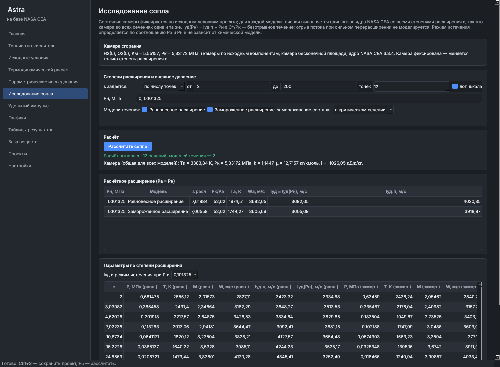
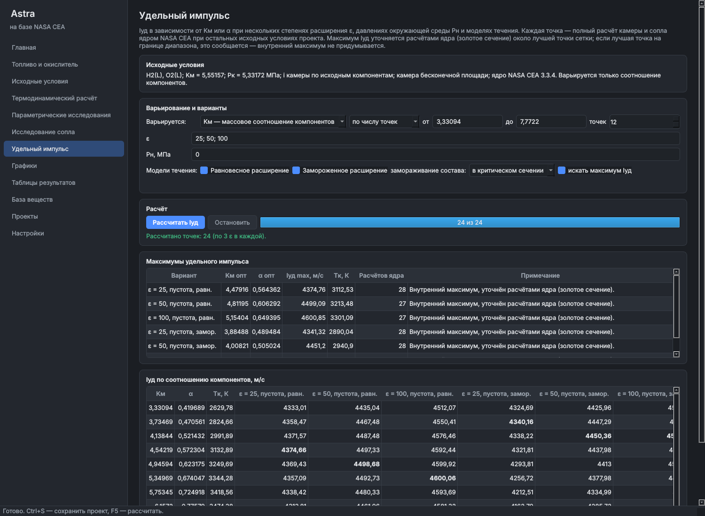

# Astra

Русскоязычный инженерный программный комплекс термодинамических расчётов
на базе вычислительного ядра NASA CEA (Chemical Equilibrium with Applications).

Назначение: расчёт химического и фазового равновесия, состава и свойств
продуктов сгорания, характеристик камеры и сопла, параметрические
исследования (Kм, α, Pк, Tк, энтальпия, ε) и анализ удельного импульса.

## Принцип

Все физические величины вычисляет оригинальное ядро NASA CEA без изменений.
Оболочка Astra задаёт исходные данные, организует серии расчётов, переводит
результаты в отечественную систему обозначений и строит таблицы и графики.
Фиктивных или приближённых «заменителей» расчёта в программе нет.

## Состояние работ

| Этап | Содержание | Статус |
|---|---|---|
| 1 | Аудит NASA CEA | выполнен, см. [docs/etap-1-audit.md](docs/etap-1-audit.md) |
| 2 | Программный интерфейс к ядру (`astra.core`) | выполнен |
| 3 | Главное окно, навигация, проекты, база веществ, обозначения | выполнен |
| 4 | Все режимы ядра в интерфейсе, сверка с эталонами NASA | выполнен |
| 5 | Параметрические исследования | выполнен |
| 6 | Исследование сопла и удельного импульса | выполнен |
| 7–9 | Графики и таблицы, тесты, установщик | запланированы |

## Параметрические исследования

Серия полных расчётов ядром при исходных условиях проекта, в которых меняются
только выбранные величины: для камеры и сопла — Kм или α, Pк, Tк или i камеры;
для равновесия — Kм или α, P или v, T, i, u или S (по постановке). Значения оси:
фиксированное, от — до с шагом, от — до числом точек (в том числе в логарифмической
шкале). Несколько осей дают все сочетания значений (до 20 000 точек). Серия считается
в фоне с прогрессом и остановкой; серии от 1500 точек по умолчанию — в нескольких
процессах. Несошедшиеся точки остаются в таблице с сообщением ядра и не заменяются.
Настройки серии сохраняются в проекте, итог серии — в журнале расчётов.

## Исследование сопла и удельного импульса

**Исследование сопла.** Камера фиксирована по исходным условиям проекта, меняется
только степень расширения ε (списком, с шагом или числом точек, в том числе в
логарифмической шкале). Для каждой модели течения — равновесной и замороженной
(с замораживанием состава в камере или в критике) — выполняется один вызов ядра со
всеми ε, поэтому камера во всех сечениях одна и та же. Для каждого Pн выводятся
Iуд(Pн) = Iуд.п − Pн·ε·C*/Pк и режим истечения (вакуум, недорасширение,
перерасширение, расчётный), который определяется по Pа и Pн отдельно от химической
модели. Для каждого Pн > 0 ядро дополнительно рассчитывает расчётное сечение
(Pа = Pн, т. е. Pк/P = Pк/Pн) — расчётная ε берётся из ядра, а не подбирается.
Отрыв потока при сильном перерасширении не моделируется; Iуд(Pн) ≤ 0 выделяется.

**Удельный импульс.** Iуд по Kм или α при нескольких ε, Pн (0 — пустота) и моделях
течения; каждая точка — полный расчёт камеры и сопла. Максимум Iуд ищется около
лучшей точки сетки методом золотого сечения по настоящим расчётам ядра (без
интерполяции); если лучшая точка лежит на границе диапазона, об этом прямо
сообщается. Таблица максимумов: Kм и α оптимума, Iуд max, Tк, число расчётов ядра.





## Режимы расчёта

| Режим | Что задаётся | Эталон NASA RP-1311 |
|---|---|---|
| TP, TV | T и P (или v) | №1, №2, №14 |
| HP, UV | P (или v); i (или u) — по исходным компонентам или явно | №3, №4 |
| SP, SV | S (обязательно) и P (или v) | согласованность с HP и TP |
| Камера и сопло, камера бесконечной площади | Pк; ε, Pк/P, дозвуковые ε; равновесное или замороженное расширение; Tк или i камеры | №8, №11, №12, №13 |
| Камера конечной площади | Fк/Fкр или удельный расход ṁ/Fк | №9, №10 |
| Ударная волна | T₁, P₁; серия W₁ или M₁; падающая и отражённая, равновесный или замороженный состав | №7 |
| Детонация Чепмена – Жуге | серии P₁ и T₁; равновесный или замороженный состав | №6 |

Для всех режимов можно включить ионы, переносные свойства (η, λ, Pr), задать
списки «только эти продукты» (only), «исключить» (omit), «включить конденсат»
(insert) и порог trace. Состав задаётся горючим и окислителем (Kм или α) или
готовой смесью (например, газовая смесь для ударной волны). Пример №5 (вещество,
отсутствующее в базе, с формулой и энтальпией, заданными пользователем) пока не
поддерживается.

## Запуск программы

```bash
python -m pip install -e ".[test]"   # Python 3.11–3.13
python -m astra                      # или команда astra
```

Разделы: «Главная», «Топливо и окислитель», «Исходные условия», «Термодинамический
расчёт» (все режимы из таблицы выше), «Параметрические исследования», «Исследование
сопла», «Удельный импульс», «База веществ», «Проекты», «Настройки» работают; разделы
графиков и таблиц появятся на этапе 7 (в них нет кнопок без действия). Проекты и журнал
расчётов хранятся в SQLite в папке данных пользователя. F5 — рассчитать, Ctrl+S — сохранить.

## Программный интерфейс к ядру (`astra.core`)

```bash
python -m pip install -e ".[test]"   # Python 3.11–3.13, Windows или Linux
python -m pytest                     # автотесты, включая эталонные задачи NASA
```

```python
from astra.core import CeaSession, Component, Propellant, Ratio, FUEL, OXIDIZER, q

prop = Propellant((Component("H2(L)", FUEL, t0=20.27),
                   Component("O2(L)", OXIDIZER, t0=90.17)))
s = CeaSession(prop)
r = s.nozzle(Ratio.alpha(0.7), pk=7e6, eps=[25, 50, 100], pn=101325.0)
for p in r.exits():
    print(q("eps").label(), p["eps"], q("isp_amb").label(), p["isp_amb"], p.regime_name)
```

Внутри `astra.core` все величины в СИ (Па, К, Дж/кг, м/с); единицы отображения
(МПа, кДж/кг и т. д.) и отечественные обозначения задаёт каталог `astra.core.notation`.

| Модуль | Назначение |
|---|---|
| `notation` | Обозначения, названия, смысл, единицы, допустимые значения |
| `propellant` | Компоненты топлива, Kм / α, параметры набора продуктов |
| `session` | Вызовы ядра: равновесие TP/HP/SP/TV/UV/SV, камера и сопло (равновесное и замороженное), ударная волна, детонация |
| `results` | Результаты: исходные данные отдельно от вычисленных, флаг сходимости |
| `grid` | Сетки параметров: фиксированное значение, шаг, число точек, логарифмическая шкала |
| `batch` | Пакетный запуск независимых точек в нескольких процессах, с отменой |

## Происхождение вычислительного ядра

Ядро — NASA CEA 3.3.4, © 2025 United States Government as represented by the
Administrator of the National Aeronautics and Space Administration, лицензия
Apache 2.0. Используется официальный пакет `cea` с PyPI, исходный код ядра
не изменяется. Тексты лицензии и уведомления NASA: [third_party/nasa-cea](third_party/nasa-cea).
Подробности — в [NOTICE.md](NOTICE.md).
